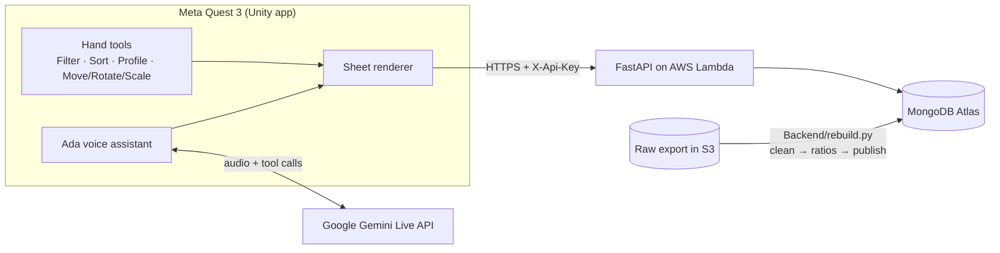

# Architecture

How the headset app, the voice assistant, the API and the data pipeline fit together, and where each lives in the repository.

## Overview

- **The app** asks the API for `/industries` at startup and fetches each sheet from `/sheet` when it is opened. Hand tools and Ada both edit the open sheet.
- **Ada** streams microphone audio and the sheet's state to the Gemini Live API and acts by calling tools (filter, sort, profile, place, query) that the app exposes.
- **The pipeline** rebuilds the database from the raw export in one run (`clean.py` → `ratios.py` → `publish.py`). `metrics.py` is the single list of ratios and categories that every stage, the API and the generated C# contract (`FinancialsContract.g.cs`) read from.

## What's in the Repository

| Path | What it holds |
|---|---|
| `Assets/Source/` | The app's C# code (see below). |
| `Assets/Scenes/Main.unity` | The one scene the app runs. |
| `Assets/StreamingAssets/` | Where your key files go (see [Configure the Project](setup.md#configure-the-project)). |
| `Assets/Settings/Build Profiles/Quest Default.asset` | The build profile for the headset. |
| `Backend/` | The Python side: rebuilds the MongoDB database from the raw export in S3 (48,429 rows, cleaned to 1,249 companies across fiscal 2019–2020) and serves it as an API on AWS Lambda. See [`Backend/README.md`](../Backend/README.md). |

The app ships no data. Every sheet is fetched from the API when it is opened.

Inside `Assets/Source/`:

| Folder | What it holds |
|---|---|
| `Core` | What the rest share: scene lookups, the camera rig, the main-thread queue, notices. |
| `Data` | Fetches and holds sheets. |
| `Sheet` | Draws them. |
| `SheetTools`, `UI` | The hand interface. |
| `Audio` | Wraps the native microphone and speaker plugins. |
| `Poster` | Builds the figures `Assets/Editor/PosterCapture.cs` renders for the poster. |
| `Gemini` | The voice assistant and the tools it calls. |

## Tech Stack

| Layer | Technology |
|---|---|
| Headset app | Unity 6 (6000.4.0f1), C#, Universal Render Pipeline, OpenXR |
| XR | Meta XR Core SDK, Meta Interaction SDK (hand tracking, poke and grab), MR Utility Kit (passthrough and scene data) |
| Voice assistant | Google Gemini Live API (`gemini-3.1-flash-live-preview`) through the Google Gen AI .NET SDK, with function calling for the sheet tools |
| API | Python 3.13, FastAPI, Mangum, on AWS Lambda (arm64) behind a Function URL, deployed with AWS SAM |
| Data | MongoDB Atlas, built from an export in Amazon S3 with pandas; secrets in AWS Systems Manager Parameter Store |
| Quality | pytest (unit, integration and regression suites), ruff, GitHub Actions |
